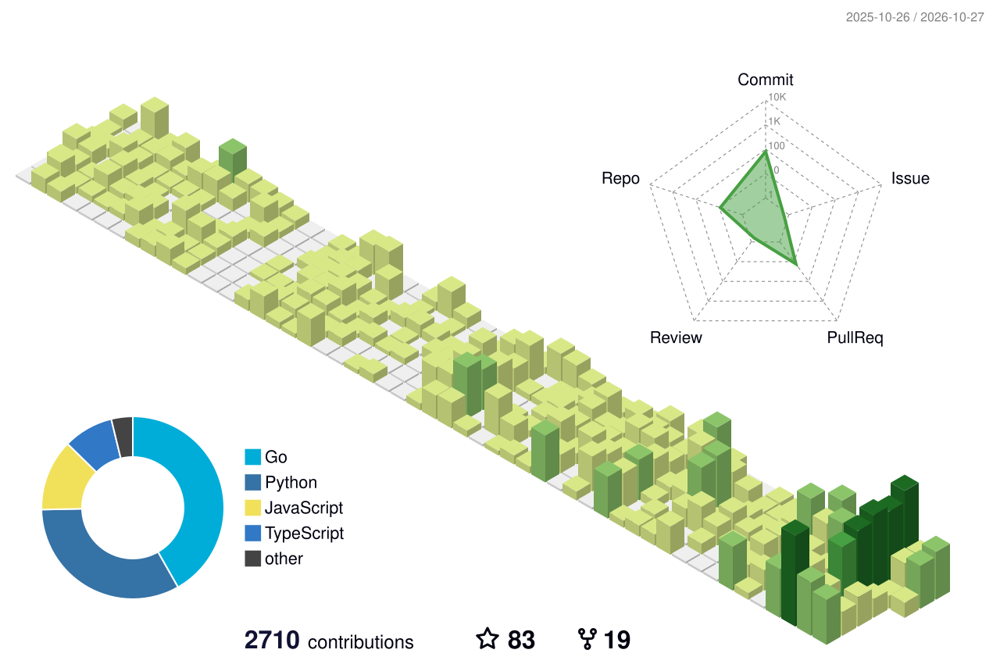

# Hi there

I am a Software Developer specializing in building highly scalable distributed systems, big data platforms, and cybersecurity infrastructure. 
I focus on transforming complex technical challenges into robust, production-ready AI fueled solutions.

I love vibe coding and I am all-in AI.

## Happy Gaming
 
 
 

